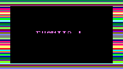
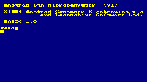
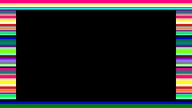
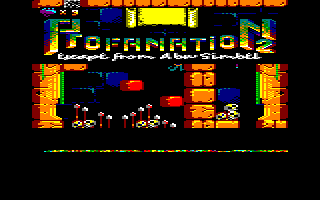

# Amstrad CPC 464 para Cardputer ADV

Emulador de **Amstrad CPC 464** para **M5Stack Cardputer ADV**, escrito en C++ y
Arduino. Arranca desde ROMs en microSD, lee discos DSK y cintas CDT, utiliza el
teclado integrado y reproduce audio AY y la señal de carga de cassette.

**Versión: FIX5 · volumen inicial: 50% · proyecto en desarrollo.**

<p align="center">
  
</p>

*Captura obtenida por USB del Cardputer en FIX4 durante la carga de Turrican.
Es la composición digital de 240×135, ampliada aquí; no una fotografía.*

[Guía completa en español](docs/GUIA.md) ·
[Descargar FIX5 para Launcher](https://github.com/NeXoDevLab/AmstradCPC464CardputerADV/releases/tag/v0.1.1-fix5) ·
[Instalación del BIN](docs/GUIA.md#5-actualizar-con-el-bin) ·
[Pruebas y límites](VALIDACION.md)

## Qué incluye

- CPC 464 de 64 KiB con Z80, Gate Array, CRTC, PPI y PSG.
- Vídeo a color: BASIC azul marino y amarillo, con la imagen completa escalada
  a la LCD de 240×135.
- Selector de juegos desde microSD; oculta los archivos auxiliares `._` de macOS.
- Lectura DSK estándar/Extended por sectores y búsqueda automática del cargador.
- Cinta CDT por streaming, motor y pausas controlados por el CPC.
- Modo de carga original con bordes de color y sonido procedentes de la
  emulación, además de modo rápido y silencioso.
- Audio AY por muestras; controles de volumen y teclado/joystick.
- Capturas USB y pruebas sintéticas que no requieren ROMs ni juegos.

FIX4 separa la LCD del productor de audio para evitar huecos periódicos y evita
recalcular la tabla de píxeles al cambiar solo el borde.
FIX5 reserva de forma fija los 64 KiB del CPC, evitando el fallo de memoria
que dejaba el arranque en «Leyendo ROMs de SD». Las ROMs se leen una sola vez
y los fallos de SD o ROM muestran un mensaje específico.

## Imágenes del dispositivo

| BASIC | Cinta original |
| --- | --- |
|  |  |



Son capturas digitales del framebuffer o de la composición LCD enviadas por USB.
[Procedencia y versiones de las imágenes](docs/images/README.md).

## Empezar

1. Prepara una microSD FAT32 con las ROMs del CPC 464 y tus juegos:
   [estructura exacta](docs/GUIA.md#2-preparar-la-microsd).
2. Con M5Launcher, copia el BIN **FIX5-app.bin** a la SD y elige instalarlo
   desde Launcher. Para una primera instalación sin Launcher utiliza Arduino
   IDE/CLI. [Procedimientos](docs/GUIA.md#5-actualizar-con-el-bin).
3. Reinicia el Cardputer. Debe aparecer BASIC.
4. Pulsa **Tab**, elige un DSK o CDT y pulsa **Enter**.
5. Para cinta original usa **O** en el selector. La carga tarda varios minutos,
   como una cinta; el centro puede ponerse negro mientras entran los bloques.

```text
/CPC464/OS.ROM       16384 bytes
/CPC464/BASIC.ROM    16384 bytes
/CPC464/AMSDOS.ROM   16384 bytes; necesario para DSK
/CPC464/GAMES/       tus archivos DSK, CDT o SNA compatibles
```

**No se incluyen ROMs ni juegos**, tampoco dentro del firmware.

## Controles principales

| Tecla | Acción |
| --- | --- |
| Tab | Selector de juegos |
| Coma / punto, o cursores | Navegar en el selector |
| Enter | Cargar |
| O / R, en el selector | Carga original / modo rápido |
| S, en el selector | Sonido de cinta ON/OFF |
| Fn+F | Alternar modo rápido |
| Fn+B | Mostrar el borde fuera de la carga |
| Fn+= / Fn+- | Subir / bajar volumen |
| Fn + flechas impresas | Cursores CPC y joystick 0 |
| Fn+espacio | Disparo |

[Todos los controles y ejemplos de carga](docs/GUIA.md#6-controles).

## Compilar

Dependencias probadas: M5Stack ESP32 **3.3.10**, M5Cardputer **1.1.1**,
M5Unified **0.2.28** y M5GFX **0.2.35**.

Con Arduino CLI y las dependencias instaladas:

```sh
sh scripts/build.sh
```

La configuración de FIX5 desactiva PSRAM y utiliza flash QIO de 8 MB,
`default_8MB`, Hardware CDC/JTAG y USB CDC al arrancar.
[Guía de compilación, instalación y descarga](docs/GUIA.md#4-compilar-con-arduino-cli).

## Estado de compatibilidad

| Formato | Alcance actual |
| --- | --- |
| DSK | Lectura de imágenes estándar/Extended; discos protegidos contra escritura |
| CDT | Bloques estándar/turbo, tonos, pulsos, datos y metadatos implementados; no todos los tipos TZX |
| SNA | Instantáneas clásicas de 64 KiB; no 128 KiB ni chunks comprimidos |
| ZIP | No implementado: descomprimir en el ordenador |

**Profanation 2** se ha comprobado por DSK y CDT en las pruebas del núcleo; en
el Cardputer se registraron la partida desde DSK y la lectura completa del CDT
hasta su introducción. La imagen de Turrican muestra una carga en curso.
Esto no implica compatibilidad con todos los juegos o cargadores.

Faltan escritura/formateo de discos, RAM de 128 KiB, bloques CSW/generalizados
y parte de las protecciones y efectos CRTC. [Resultados y límites](VALIDACION.md).

## Pruebas

Pruebas sintéticas sin medios externos:

```sh
sh scripts/check-peripherals.sh
```

Ensayo de integración para las ediciones de Profanation utilizadas durante el
desarrollo, aportando tus archivos:

```sh
sh tests/run_host.sh /ruta/roms /ruta/Profanation.dsk /ruta/Profanation.cdt
```

[Diagnóstico y capturas USB](docs/GUIA.md#10-capturar-imágenes-por-usb).

## Créditos y licencia

El núcleo se basa en [ESP32TinyCPC](https://github.com/rpsubc8/ESP32TinyCPC)
de rpsubc8/Ackerman, port del emulador CPC de Tom Walker. Se conserva la
[licencia WTFPL](LICENSE).
[Créditos, dependencias y derechos de las capturas](THIRD_PARTY_NOTICES.md).
