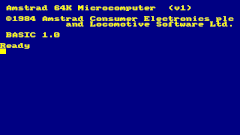
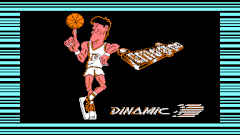
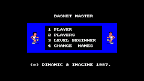
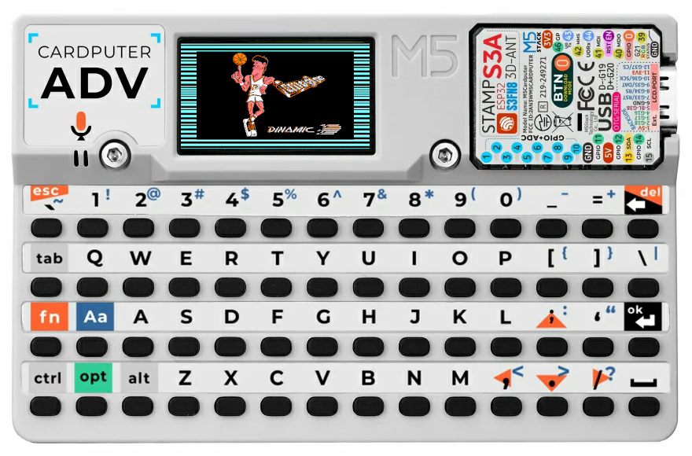
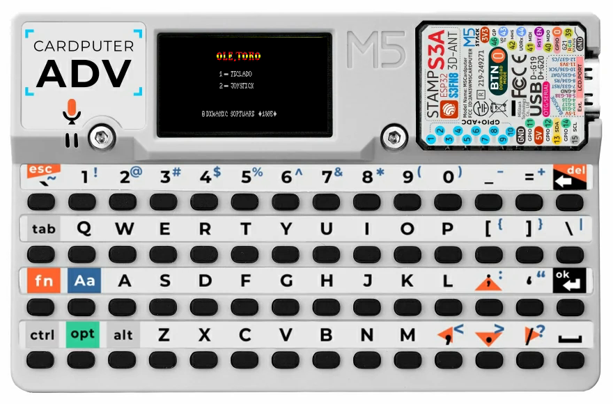

# Amstrad CPC 464 para Cardputer ADV

Emulador de **Amstrad CPC 464** para **M5Stack Cardputer ADV**, escrito en C++ y
Arduino. Arranca desde ROMs en microSD, lee discos DSK y cintas CDT, utiliza el
teclado integrado y reproduce audio AY y la señal de carga de cassette.

**Versión: FIX12 · volumen inicial: 30% · proyecto en desarrollo.**

[Guía completa en español](docs/GUIA.md) ·
[BIN FIX12 para Launcher](firmware/AmstradCPC464-CardputerADV-FIX12-app.bin) ·
[Instalación del BIN](docs/GUIA.md#5-actualizar-con-el-bin) ·
[Pruebas y límites](VALIDACION.md)

## Capturas y vídeos actuales

| BASIC · FIX12 | Cinta original · FIX12 | Juego cargado · FIX12 |
| :---: | :---: | :---: |
|  |  |  |

| Fernando Martín · 4:51 | Olé Toro · 5:57 |
| :---: | :---: |
| <a href="https://nexodevlab.github.io/AmstradCPC464CardputerADV/#fernando"></a> | <a href="https://nexodevlab.github.io/AmstradCPC464CardputerADV/#ole-toro"></a> |

**[Abrir la galería con los dos reproductores en una fila](https://nexodevlab.github.io/AmstradCPC464CardputerADV/#videos).**
La LCD de cada vídeo conserva sus **240×135 píxeles** dentro de la fotografía
facilitada del Cardputer ADV. Las cintas están completas y mantienen su sonido.
Las tres capturas son de FIX12; los vídeos se grabaron en FIX11, con el mismo
filtro de pantalla. [Procedencia](docs/images/README.md) ·
[Comparación del texto](docs/images/texto-fix11-comparacion.png).

## Qué incluye

- CPC 464 de 64 KiB con Z80, Gate Array, CRTC, PPI y PSG.
- Vídeo a color: BASIC azul marino y amarillo, con la imagen completa escalada
  a la LCD de 240×135.
- Selector de juegos desde microSD; oculta los archivos auxiliares `._` de macOS.
- Lectura DSK estándar/Extended y búsqueda automática del cargador, incluidos
  ejecutables sin extensión o con una extensión distinta de BAS/BIN.
- Cinta CDT por streaming, motor y pausas controlados por el CPC.
- Modo de carga original con bordes de color y sonido procedentes de la
  emulación, además de modo rápido y silencioso.
- Audio AY por muestras; controles de volumen y teclado/joystick.
- Capturas USB y pruebas sintéticas que no requieren ROMs ni juegos.

FIX4 separa la LCD del productor de audio para evitar huecos periódicos y evita
recalcular la tabla de píxeles al cambiar solo el borde.
FIX5 reserva de forma fija los 64 KiB del CPC, evitando el fallo de memoria
que dejaba el arranque en «Leyendo ROMs de SD». Las ROMs se leen una sola vez
y los fallos de SD o ROM muestran un mensaje específico.
FIX6 amplía el área activa de los juegos a toda la LCD, conserva los bordes
durante la carga original y ajusta los tamaños de texto del selector y arranque.
FIX7 permite separar las cintas en `GAMES/CDT/` y los discos en `GAMES/DSK/`,
entrar en carpetas y volver con Retroceso o `[ .. ] Volver`. Los juegos que
quedan directamente en `GAMES/` también aparecen en el selector.
FIX9 arranca con el volumen al 30% y permite ajustarlo con `Fn` + `=` (tecla
del signo `+`) y `Fn` + `-` en pasos del 5%, durante la emulación y en el
selector. Sin Fn, los signos mantienen su función en el CPC.
FIX10 reconoce cargadores DSK sin extensión o con extensiones no habituales
mediante su cabecera AMSDOS, y separa el movimiento por filas y páginas.
FIX11 mejora la lectura del texto al reducir la imagen: conserva los trazos
finos y utiliza colores RGB565 para suavizar sus bordes, manteniendo el área
completa y los colores planos originales del CPC.
FIX12 activa las flechas impresas y espacio para jugar sin mantener Fn al cargar
un CDT, DSK o SNA. Fn+J permite volver al teclado de BASIC; el arranque en BASIC
conserva la escritura de signos. El volumen sigue usando Fn+= y Fn+-.

## Empezar

1. Prepara una microSD FAT32 con las ROMs del CPC 464 y tus juegos:
   [estructura exacta](docs/GUIA.md#2-preparar-la-microsd).
2. Con M5Launcher, copia el BIN **FIX12-app.bin** a la SD y elige instalarlo
   desde Launcher. Para una primera instalación sin Launcher utiliza Arduino
   IDE/CLI. [Procedimientos](docs/GUIA.md#5-actualizar-con-el-bin).
3. Reinicia el Cardputer. Debe aparecer BASIC.
4. Pulsa **Tab**, entra en **CDT** o **DSK** con **Enter** y elige el juego.
5. Para cinta original usa **O** en el selector. La carga tarda varios minutos,
   como una cinta; el centro puede ponerse negro mientras entran los bloques.

```text
/CPC464/OS.ROM       16384 bytes
/CPC464/BASIC.ROM    16384 bytes
/CPC464/AMSDOS.ROM   16384 bytes; necesario para DSK
/CPC464/GAMES/CDT/   tus cintas CDT
/CPC464/GAMES/DSK/   tus discos DSK
/CPC464/GAMES/       también admite juegos sueltos e instantáneas SNA
```

**No se incluyen ROMs ni juegos**, tampoco dentro del firmware.

## Controles principales

| Tecla | Acción |
| --- | --- |
| Tab | Selector de juegos |
| Arriba / abajo; también `;` / `.` | Mover una entrada en el selector |
| Izquierda / derecha; también `,` / `/` | Cambiar una página de seis entradas |
| Enter | Entrar en una carpeta o cargar un juego |
| Retroceso / `[ .. ] Volver` | Volver a la carpeta anterior |
| O / R, en el selector | Carga original / modo rápido |
| S, en el selector | Sonido de cinta ON/OFF |
| Fn+F | Alternar modo rápido |
| Fn+B | Mostrar el borde fuera de la carga |
| Fn+= / Fn+- | Subir / bajar volumen en pasos del 5% |
| + / - / = sin Fn | Escribir los signos dentro del CPC |
| Flechas impresas, sin Fn | Cursores CPC y joystick 0 al cargar un juego |
| Espacio, sin Fn | Disparo; también envía espacio al CPC |
| Fn+J | Alternar controles de juego y teclado de BASIC |

[Todos los controles y ejemplos de carga](docs/GUIA.md#6-controles).

## Compilar

Dependencias probadas: M5Stack ESP32 **3.3.10**, M5Cardputer **1.1.1**,
M5Unified **0.2.28** y M5GFX **0.2.35**.

Con Arduino CLI y las dependencias instaladas:

```sh
sh scripts/build.sh
```

La configuración de FIX12 desactiva PSRAM y utiliza flash QIO de 8 MB,
`default_8MB`, Hardware CDC/JTAG y USB CDC al arrancar.
[Guía de compilación, instalación y descarga](docs/GUIA.md#4-compilar-con-arduino-cli).

## Estado de compatibilidad

| Formato | Alcance actual |
| --- | --- |
| DSK | Lectura de imágenes estándar/Extended; discos protegidos contra escritura |
| CDT | Bloques estándar/turbo, tonos, pulsos, datos y metadatos implementados; no todos los tipos TZX |
| SNA | Instantáneas clásicas de 64 KiB; no 128 KiB ni chunks comprimidos |
| ZIP | No implementado: descomprimir en el ordenador |
| TAP | No implementado; para cintas utiliza CDT de Amstrad CPC |

**Profanation 2** se ha comprobado por DSK y CDT en las pruebas del núcleo; en
el Cardputer se registraron la partida desde DSK y la lectura completa del CDT
hasta su introducción. Fernando Martín y Olé Toro se grabaron hasta sus menús
en FIX11; se repitió la carga de Fernando Martín para las capturas FIX12.
Esto no implica compatibilidad con todos los juegos o cargadores.

Faltan escritura/formateo de discos, RAM de 128 KiB, bloques CSW/generalizados
y parte de las protecciones y efectos CRTC. [Resultados y límites](VALIDACION.md).

## Pruebas

Pruebas sintéticas sin medios externos:

```sh
sh scripts/check-peripherals.sh
```

Ensayo de integración para las ediciones de Profanation utilizadas durante el
desarrollo, aportando tus archivos:

```sh
sh tests/run_host.sh /ruta/roms /ruta/Profanation.dsk /ruta/Profanation.cdt
```

[Diagnóstico y capturas USB](docs/GUIA.md#10-capturar-imágenes-por-usb).

## Créditos y licencia

El núcleo se basa en [ESP32TinyCPC](https://github.com/rpsubc8/ESP32TinyCPC)
de rpsubc8/Ackerman, port del emulador CPC de Tom Walker. Se conserva la
[licencia WTFPL](LICENSE).
[Créditos, dependencias y derechos de las capturas](THIRD_PARTY_NOTICES.md).
