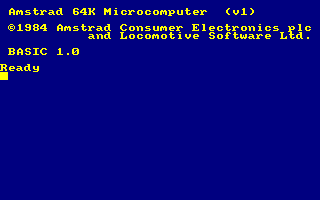
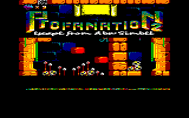
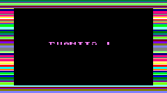

# Guía completa · Amstrad CPC 464 en Cardputer ADV

Esta guía corresponde a **FIX4**, con carga desde microSD, modos de cinta
original y rápido, audio AY y volumen inicial del 50%.

## 1. Qué necesitas

- M5Stack **Cardputer ADV**. Esta versión se ha probado con este modelo.
- Cable USB-C de datos y un ordenador con macOS, Linux o Windows.
- microSD en FAT32, con una copia de seguridad de lo que ya tengas guardado.
- ROMs de CPC 464 de 16 KiB y tus propios juegos. No se distribuyen aquí.
- Arduino IDE 2 o Arduino CLI si vas a compilar.

La placa probada tiene 8 MB de flash e informa de 0 bytes de PSRAM. El proyecto
no necesita PSRAM: mantiene los 64 KiB del CPC en SRAM y lee discos y cintas
por bloques. Información del dispositivo: [documentación oficial de M5Stack](https://docs.m5stack.com/en/core/Cardputer-Adv).

## 2. Preparar la microSD

La raíz de la tarjeta debe contener esta estructura:

```text
CPC464/
├── OS.ROM            # sistema del CPC 464, exactamente 16384 bytes
├── BASIC.ROM         # BASIC del CPC 464, exactamente 16384 bytes
├── AMSDOS.ROM        # exactamente 16384 bytes; necesario para DSK
└── GAMES/
    ├── juego.dsk
    ├── juego.cdt
    └── instantanea.sna
```

Respeta los nombres y las mayúsculas de las carpetas y ROMs. Evita mezclar el
sistema de un CPC 6128 con el BASIC de un CPC 464. `AMSDOS.ROM` no es
`MSDOS.ROM`: se trata de la ROM del sistema de discos del CPC.

Las ROMs y juegos quedan fuera de este repositorio y de sus binarios. Las
capturas de juegos sirven para documentar las pruebas; no contienen las imágenes
DSK/CDT que necesitarías para ejecutarlos.

macOS puede crear archivos `._nombre`. El selector los oculta automáticamente;
no es necesario borrarlos para utilizar el emulador. Expulsa la tarjeta desde el
sistema antes de desconectarla.

## 3. Instalar con Arduino IDE

1. Descarga el código y conserva el nombre de carpeta
   `AmstradCPC464CardputerADV`, igual que el archivo `.ino`.
2. Instala el paquete de placas **M5Stack** siguiendo su
   [guía de instalación](https://docs.m5stack.com/en/arduino/arduino_board).
3. Instala las bibliotecas M5Cardputer, M5Unified y M5GFX. Las versiones
   utilizadas se indican en la tabla de la sección siguiente.
4. Abre `AmstradCPC464CardputerADV.ino`.
5. Selecciona **M5Cardputer**, el puerto USB del ADV y estas opciones:

   | Opción | Valor |
   | --- | --- |
   | PSRAM | Disabled |
   | Flash Mode | QIO |
   | Flash Size | 8 MB |
   | Partition Scheme | Default 8 MB |
   | USB Mode | Hardware CDC and JTAG |
   | USB CDC On Boot | Enabled |

6. Compila y pulsa Subir. La instalación por Arduino escribe también los
   componentes de arranque necesarios para una placa recién preparada.
7. Inserta la microSD y reinicia. Debe aparecer BASIC con papel azul marino y
   texto amarillo.



Si no entra en modo de descarga, la guía oficial del ADV indica: interruptor
lateral en OFF, mantener **G0** pulsado al conectar el cable USB de datos y
soltarlo cuando el dispositivo se encienda.
[Procedimiento oficial](https://docs.m5stack.com/en/core/Cardputer-Adv#download-mode).

## 4. Compilar con Arduino CLI

Configuración usada para FIX4:

| Componente | Versión probada |
| --- | --- |
| M5Stack ESP32 | 3.3.10 |
| M5Cardputer | 1.1.1 |
| M5Unified | 0.2.28 |
| M5GFX | 0.2.35 |

Tras configurar el índice de placas M5Stack, instala las dependencias:

```sh
arduino-cli config add board_manager.additional_urls https://static-cdn.m5stack.com/resource/arduino/package_m5stack_index.json
arduino-cli core update-index
arduino-cli core install m5stack:esp32@3.3.10
arduino-cli lib install "M5Cardputer@1.1.1" "M5Unified@0.2.28" "M5GFX@0.2.35"
```

Desde la carpeta del proyecto:

```sh
sh scripts/build.sh
```

El script utiliza este identificador de placa:

```text
m5stack:esp32:m5stack_cardputer:PSRAM=disabled,FlashMode=qio,FlashSize=8M,PartitionScheme=default_8MB,USBMode=hwcdc,CDCOnBoot=cdc
```

Deja los resultados en `.build-verified/`. Si el ejecutable no está en PATH,
puedes indicar su ruta:

```sh
CPC_ARDUINO_CLI="/ruta/a/arduino-cli" sh scripts/build.sh
```

Para subirlo, cierra antes cualquier monitor serie:

```sh
arduino-cli board list
arduino-cli upload \
  --fqbn 'm5stack:esp32:m5stack_cardputer:PSRAM=disabled,FlashMode=qio,FlashSize=8M,PartitionScheme=default_8MB,USBMode=hwcdc,CDCOnBoot=cdc' \
  --input-dir .build-verified --port PUERTO .
```

Sustituye `PUERTO` por `/dev/cu.usbmodem…` en macOS, `/dev/ttyACM…` en Linux o
`COM…` en Windows. Comprueba que corresponde al Cardputer ADV si hay varias
placas conectadas.

## 5. Actualizar con el BIN

El archivo de `firmware/` es **solo la aplicación**, compilada con la
configuración anterior. Se escribe en **0x10000** y requiere que la placa ya
tenga el cargador de arranque y las particiones compatibles. Para la primera
instalación utiliza la sección 3 o 4, o el binario completo si se ofrece en una
release. Un binario completo y uno de aplicación no se escriben en la misma
dirección.

Con esptool 5 instalado y el puerto identificado:

```sh
python3 -m esptool --chip esp32s3 --port PUERTO --baud 460800 \
  write-flash --flash-mode keep --flash-freq keep --flash-size keep \
  0x10000 firmware/AmstradCPC464-CardputerADV-FIX4-app.bin
```

Este comando actualiza la aplicación y reinicia el dispositivo. No modifica los
archivos de la microSD. La escritura debe terminar con la verificación del hash.
La suma SHA-256 del BIN publicado está en `firmware/SHA256SUMS`.

## 6. Controles

| Tecla | Acción |
| --- | --- |
| Tab | Abrir selector de juegos |
| Botón A / G0, si está disponible | Acceso alternativo al selector |
| Coma / punto | Anterior / siguiente en el selector |
| Arriba / abajo | Navegar en el selector |
| Enter | Seleccionar y cargar |
| Tecla de acento grave | Salir del selector |
| O, en el selector | Carga original: bordes y sonido de cinta |
| R, en el selector | Modo rápido, con audio silenciado |
| S, en el selector | Activar / desactivar el sonido de cinta |
| Fn+F | Alternar modo rápido durante la ejecución |
| Fn+B | Mostrar / ocultar el borde fuera de la carga |
| Fn+= / Fn+- | Subir / bajar volumen, con porcentaje en pantalla |
| Fn + flechas impresas | Cursores CPC y joystick 0 |
| Fn+espacio | Disparo del joystick 0 |

Las letras, números, símbolos, Enter, retroceso, Escape, Shift, Ctrl y las teclas
de función disponibles se traducen a la matriz CPC. La tecla A escribe A;
no abre el selector. Los controles dentro de cada juego dependen del propio
juego: puede ser necesario escoger teclado o joystick en su menú.

## 7. Cargar DSK

1. Copia el DSK en `/CPC464/GAMES/` y comprueba que exista `AMSDOS.ROM`.
2. Abre el selector con Tab, elige el disco y pulsa Enter.
3. El emulador monta la imagen, reinicia el CPC y escribe `|DISC`.
4. Busca un cargador BAS/BIN en el directorio del disco. Da prioridad a nombres
   como `DISC`, `DISK`, `LOADER` o `MENU` y escribe el comando RUN correspondiente.
5. Si no encuentra un cargador reconocido, escribe `CAT` para mostrar el
   directorio. No significa que todos los discos puedan arrancarse automáticamente.

También puedes escribir desde BASIC, pulsando Enter al final de cada línea:

```text
|DISC
CAT
RUN"DISC
```

`DISC` es un ejemplo: usa el nombre del programa que aparezca en tu disco.
No basta con montar una imagen para que cualquier juego arranque. Los discos
están protegidos contra escritura; guardar partidas en el DSK no está implementado.



## 8. Cargar CDT como una cinta original

1. Copia el CDT en `/CPC464/GAMES/`.
2. Abre el selector y pulsa O para elegir el modo original.
3. Selecciona la cinta y pulsa Enter.
4. El emulador monta la cinta, reinicia el CPC y escribe `|TAPE`, `RUN"` y
   una pulsación de espacio para comenzar.
5. Espera. El motor, las pausas y los pulsos se ejecutan durante la emulación;
   una carga puede tardar varios minutos. Algunas pantallas centrales se ponen
   negras mientras entran los bloques.

Los cambios de color del borde proceden del Gate Array y la señal audible de
los pulsos del CDT. La imagen incluye el área central completa y un borde
durante la carga original. Su aspecto depende del cargador de cada juego:
no todas las cintas muestran las mismas franjas o tienen el mismo sonido.



Para acelerar una carga usa R en el selector o Fn+F. Ese modo reduce el trabajo
de vídeo y silencia el audio; no sustituye la cinta por una instantánea. La
aceleración depende del coste de emulación del juego. Desactívalo para jugar
a velocidad normal y escuchar el sonido.

## 9. Vídeo y sonido

La pantalla física es de 240×135. El área CPC de 320×200 se reduce completa;
durante la cinta se compone una vista de 384×240 que incluye el borde. Fuera
de la carga, Fn+B permite mostrarlo para ver los cambios de `BORDER` desde BASIC.
El BASIC arranca con azul marino y amarillo.

El volumen inicial es 50%. Fn+= lo sube y Fn+- lo baja. El audio mezcla los
canales AY y, si está activada, la señal de cinta. S afecta a la cinta; el modo
rápido silencia la salida. Una pausa de cinta debe distinguirse de un bloqueo:
puede haber silencio o pantalla negra durante partes de la carga.

FIX4 mueve las transferencias de LCD a otra tarea y mantiene el audio prioritario.
Esto corrige los huecos periódicos que podían oírse como un zumbido añadido al
sonido de cinta. Las mediciones y sus límites están en [VALIDACION.md](../VALIDACION.md).

## 10. Capturar imágenes por USB

El script incluido utiliza Python estándar y las interfaces serie de
macOS/Linux. No necesita pyserial. Cierra otros monitores serie y ejecuta:

```sh
python3 tests/device_probe.py PUERTO '?'
python3 tests/device_probe.py PUERTO v carga.ppm
```

`v` obtiene la composición de 240×135, incluido el borde cuando esté activo.
`s` obtiene el framebuffer CPC central de 320×200:

```sh
python3 tests/device_probe.py PUERTO s pantalla-cpc.ppm
```

En macOS puedes convertir una captura a PNG:

```sh
sips -s format png carga.ppm --out carga.png
```

Las capturas del repositorio se han obtenido así desde el dispositivo. Son
capturas digitales, no fotografías. Capturar interrumpe brevemente la emulación
mientras transmite los píxeles; no lo hagas si estás midiendo continuidad de audio.
El diagnóstico USB del script no funciona dentro del bucle bloqueante del selector:
sal del menú para utilizarlo.

Otros comandos técnicos: `l` lista imágenes; `d` / `t` montan un DSK/CDT de prueba
(con preferencia por Profanation si está presente); `3` pulsa esa tecla; `f`
alterna modo rápido y `c` reinicia los contadores de audio. No los uses durante
una partida que quieras conservar: los de montaje reinician el CPC.

## 11. Solución de problemas

| Síntoma | Qué comprobar |
| --- | --- |
| No aparece un puerto USB | Cable de datos, puerto correcto y modo G0 de descarga |
| SD no disponible | Tarjeta FAT32, inserción correcta y lectura desde el ordenador |
| Faltan ROMs | Rutas exactas y tamaño de 16384 bytes de OS/BASIC |
| Falta AMSDOS | Copiar `AMSDOS.ROM`; no renombrar una ROM de MS-DOS |
| Lista vacía | Carpeta `GAMES`, extensiones DSK/CDT/SNA y máximo 64 entradas visibles |
| DSK vuelve a BASIC | Revisar `CAT`, nombre del cargador y compatibilidad del disco |
| CDT negro y con ruido | Puede estar cargando; consultar avance `tape_bytes` por USB |
| No hay sonido | Modo original, S activado y volumen; el modo rápido es silencioso |
| Sonido bajo | Fn+=; el volumen inicial es 50% |
| Se ven archivos duplicados en macOS | El selector oculta los `._`; el Finder puede mostrarlos igualmente |
| ZIP no aparece | Descomprimir en el ordenador y copiar DSK/CDT/SNA compatibles |
| SNA inválido | Solo se contemplan instantáneas clásicas de 64 KiB; no 128 KiB ni chunks comprimidos |
| Reinicios al habilitar PSRAM | Usar el perfil probado con PSRAM desactivada |

Al informar de un fallo indica FIX4, formato y mensaje, si estaba activo O/R,
y los datos de diagnóstico. Una captura ayuda a distinguir el cargador, BASIC
y el menú del emulador.

## 12. Pruebas y compatibilidad real

Las pruebas completas utilizan los dos archivos de Profanation 2 aportados
durante el desarrollo y las ROMs del usuario. No se incluyen en el repositorio.

```sh
sh tests/run_host.sh /ruta/a/roms /ruta/a/Profanation.dsk /ruta/a/Profanation.cdt
```

Ese ensayo es específico de la edición probada, cuyo cargador se llama DISC.
No es un comprobador universal para cualquier DSK/CDT. Ejecuta el mismo núcleo
con sanitizadores, llega al menú y entra en la partida. Las pruebas sintéticas
de CI no necesitan ROMs y comprueban teclado, colores, cinta, errores FDC y audio.

Se han comprobado DSK y CDT de Profanation 2; la captura de Turrican muestra una
carga en curso, no certifica que el juego completo haya pasado las mismas pruebas.
Faltan escritura de discos, ZIP, RAM de 128 KiB, bloques de cinta CSW/generalizados
y parte de las protecciones y efectos CRTC. Consulta también
[VALIDACION.md](../VALIDACION.md) y [los créditos](../THIRD_PARTY_NOTICES.md).
