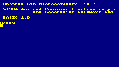

# FIX5 · Corrección del arranque con M5Launcher

Se corrige el arranque que quedaba en «Leyendo ROMs de SD» por un fallo al
reservar los 64 KiB del CPC después de inicializar los controladores. La RAM
del CPC queda reservada de forma fija. Las ROMs se leen una sola vez y los
errores de SD/ROM muestran el paso y la ruta afectados.

Usa `AmstradCPC464-CardputerADV-FIX5-app.bin` desde el explorador de SD de
M5Launcher. Launcher determina la partición; no se necesita el BIN completo
de 8 MB. La guía distingue esta instalación de la independiente por USB.

Se mantiene el volumen inicial del 50%, el audio y el vídeo de FIX4. No se
incluyen ROMs ni juegos. La suma SHA-256 del BIN se adjunta en `SHA256SUMS`.

## Comprobaciones

- Tres arranques completos con las particiones de Launcher y BASIC a color.
- Profanation 2 por DSK: pantalla gráfica y menú del juego.
- Profanation 2 por CDT: inicio de carga original y avance de lectura sin error.
- Pruebas sintéticas de teclado, paleta, vídeo, cinta, FDC y audio correctas.

Esta comprobación de FIX5 cubre el inicio de la carga CDT; la prueba completa
anterior del archivo corresponde a FIX4. No implica compatibilidad universal.

[Guía completa e instalación](https://github.com/NeXoDevLab/AmstradCPC464CardputerADV/blob/v0.1.1-fix5/docs/GUIA.md) ·
[Resultados y límites](https://github.com/NeXoDevLab/AmstradCPC464CardputerADV/blob/v0.1.1-fix5/VALIDACION.md)

