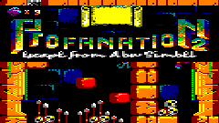

# FIX9 · Pantalla, carpetas de juegos y volumen con Fn

Actualización para M5Stack Cardputer ADV que reúne los cambios posteriores a
FIX5, conservando la corrección del arranque desde M5Launcher.

## Cambios

- El área activa del juego se adapta a la LCD completa de 240×135 según el
  CRTC. Se conserva la imagen completa y los márgenes que dibuja cada juego.
- La carga original conserva los bordes de color y el sonido de la cinta.
  El marco de carga se libera al terminar la cinta y detenerse su motor.
- Lista de juegos con letras de 10 píxeles y seis filas; textos de carga
  de 10 píxeles, encabezado de carga de 18 y título inicial amarillo de 19.
- Carpetas `GAMES/CDT/` y `GAMES/DSK/`, subcarpetas y vuelta con Retroceso
  o `[ .. ] Volver`. Las carpetas se muestran como `[ CDT ]` y `[ DSK ]`.
- Los juegos sueltos en `GAMES/` siguen apareciendo. Se ocultan los nombres
  que empiezan por punto, incluidos los archivos `._` de macOS.
- Volumen inicial del **30%**. **Fn+=** sube y **Fn+-** baja en pasos del 5%,
  de 0 a 100%, durante la emulación y en el selector. No hace falta Mayús:
  `=` comparte tecla con `+`. Sin Fn, los signos se escriben en el CPC.
- Guía, capturas, diagnóstico USB y pruebas de navegación actualizados.

## Instalar

Descarga **AmstradCPC464-CardputerADV-FIX9-app.bin**, cópialo a la microSD
y selecciónalo desde M5Launcher para instalarlo. Es **solo la aplicación**:
Launcher elige su partición; no necesitas una imagen completa de 8 MB.
Las ROMs deben seguir en `/CPC464/` y los juegos en `/CPC464/GAMES/`.

El BIN ocupa **735.920 bytes**. `SHA256SUMS` permite comprobar su integridad.
Para una instalación independiente por USB, sigue la guía y comprueba la
tabla de particiones antes de elegir una dirección de escritura.

## Comprobaciones y límites

Se ha compilado e instalado FIX9 en el Cardputer ADV conservando Launcher,
con escritura verificada por hash. Por USB se comprobaron el arranque al
30%, los pasos 30→35→30, los límites 0–100% y el ajuste dentro del selector.
Las pruebas con ASan/UBSan verifican teclado, vídeo, cinta, FDC, audio y
navegación por carpetas, incluidos colisiones y fallos al mover archivos.

Las capturas y pruebas de juegos documentadas pertenecen a las revisiones
indicadas en la guía de validación; no se ha comprobado todo el catálogo.
No se incluyen ROMs ni juegos. ZIP y TAP siguen sin estar implementados;
el modo rápido de CDT acelera la cinta, pero no es una carga instantánea.

[Guía completa e instalación](https://github.com/NeXoDevLab/AmstradCPC464CardputerADV/blob/v0.1.2-fix9/docs/GUIA.md) ·
[Resultados y límites](https://github.com/NeXoDevLab/AmstradCPC464CardputerADV/blob/v0.1.2-fix9/VALIDACION.md)

